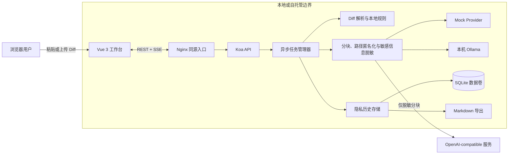
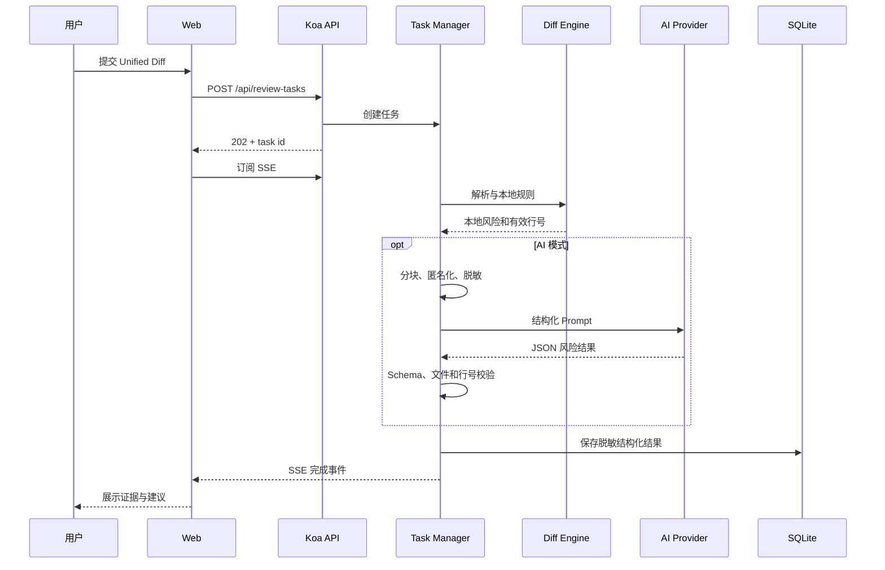

# 架构说明

## 系统结构

外部 Provider 只接收预算内的匿名化、脱敏分块。真实文件路径、完整原始 Diff 和 API Key 不写入 SQLite；历史记录只保留 Diff SHA-256、统计、Provider 元数据和脱敏后的结构化结果。

## 审查链路

## 代码边界

| 模块                   | 职责                                    | 关键约束                           |
| ---------------------- | --------------------------------------- | ---------------------------------- |
| `packages/diff-engine` | Diff 解析、本地规则、分块和敏感信息扫描 | 纯本地、确定性、无网络调用         |
| `apps/server`          | Provider、任务状态、SSE、历史和导出     | 模型输出必须通过 Schema 与证据校验 |
| `apps/web`             | 输入、进度、结果、历史和导出界面        | 凭据不进入浏览器配置               |
| `deploy/nginx.conf`    | 静态资源与同源 API 代理                 | 关闭 API 响应缓冲以支持 SSE        |
| `evaluation`           | 虚构样本和预期结果                      | 不调用外部模型，可重复执行         |

## 部署结构

`compose.yaml` 启动两个容器：`web` 在 `localhost:8080` 提供页面并代理 `/api`，`api` 只在 Compose 网络内暴露 `3000`；命名数据卷 `review-data` 持久化 SQLite。两个镜像均包含健康检查，Web 会等待 API 健康后启动。
