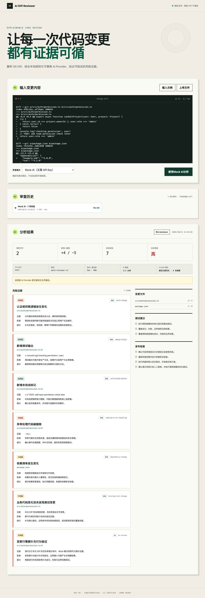

# 演示指南



## 3 分钟演示脚本

1. 打开工作台，说明页面内置完全虚构的风险 Diff，默认 Mock AI 不需要 API Key。
2. 点击“使用 Mock AI 分析”，观察解析、本地规则、AI 审查、保存和完成的 SSE 进度。
3. 展示统计、风险等级、真实文件与行号、证据、影响、建议和风险来源。
4. 展示 Prompt 隐私信息：文件路径已匿名化，凭据或个人信息会在 Provider 调用前替换为类型占位符。
5. 打开审查历史并导出 Markdown，说明 SQLite 与报告都不保存原始 Diff 或 hunk。
6. 切换本地规则模式，说明完全离线路径；最后展示 `pnpm eval` 的 16 个确定性样本结果。

## 本地演示

```bash
pnpm install
pnpm dev
```

打开 <http://localhost:5173>。默认样例可直接演示，也可上传 `samples/day-01-risky.diff`。

## Docker 演示

```bash
docker compose up --build
```

打开 <http://localhost:8080>。默认使用 Mock AI；SQLite 保存在 `review-data` 数据卷。结束演示：

```bash
docker compose down
```

只有在明确需要清空演示历史时才删除数据卷：

```bash
docker compose down --volumes
```

## 验证命令

```bash
pnpm check
pnpm eval
SMOKE_BASE_URL=http://localhost:8080 pnpm test:smoke
```

`pnpm check` 包含 lint、类型检查、单元/API 测试、生产构建和真实 HTTP 冒烟测试。`pnpm eval` 验证本地规则与脱敏评测集，最后一条命令可对正在运行的 Docker 环境重复执行同一条冒烟链路。

## 演示边界

- 不输入公司代码、内部地址、真实凭据或个人信息。
- OpenAI-compatible 会将脱敏后的必要分块发送到服务端配置的地址；演示默认坚持使用 Mock AI。
- 工具提供风险信号与证据，不替代人工代码审查、安全审计或完整测试。
